

  
  <h1>USee</h1>
  
<strong>반려동물을 찾는 일부터, 새 가족을 맞이하는 준비까지</strong>

  
시민과 예비 보호자, 보호소를 연결하는 반려동물 서비스

  

    <a href="#프로젝트-소개">프로젝트 소개</a> ·
    <a href="#서비스-기능">서비스 기능</a> ·
    <a href="#시연-화면">시연 화면</a>
    (<a href="#모바일-앱">모바일 앱</a> ·
    <a href="#보호소-웹">보호소 웹</a>)
  

  

    <a href="#기술-하이라이트">기술 하이라이트</a> ·
    <a href="#아키텍처">아키텍처</a> ·
    <a href="#기술-스택">기술 스택</a> ·
    <a href="#팀원-소개">팀원 소개</a> ·
    <a href="#개발-가이드">개발 가이드</a>
  

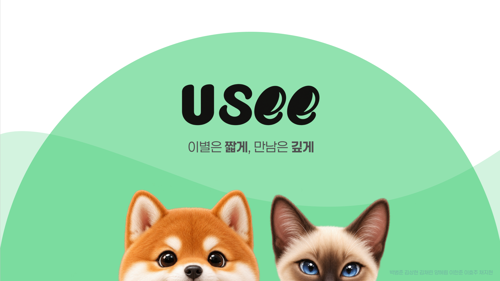

## 프로젝트 소개

**2026.10.06 – 2026.12.01 · SSAFY 15기 자유 프로젝트 · 7인 팀**

실종 동물의 보호자는 여러 제보와 보호 공고를 일일이 비교해야 하고, 예비 입양자는 입양 전에 돌봄과 비용을 가늠하기 어렵습니다. USee는 **사진으로 확인할 후보를 좁히고**, **7일 모의 입양**으로 입양 전 준비를 돕습니다.

## 서비스 기능

| 기능 | 사용 흐름 |
| :--- | :--- |
| **실종 신고 · 발견 제보** | 사진·특징·위치를 등록합니다. 발견 제보를 작성할 때 AI 품종 추천을 확인할 수 있습니다. |
| **유사 동물 매칭** | 발견 제보나 보호 동물 중 실종 사진과 닮은 후보가 생기면 알림을 받습니다. |
| **보호 동물 탐색 · 채팅** | 보호 공고를 찾아보고 관심 동물을 저장하거나 채팅으로 문의합니다. |
| **7일 모의 입양 · 돌봄 리포트** | 가상 반려동물을 돌보며 예산과 돌발 상황에 대응하고, 체험 후 기록과 지출을 돌아봅니다. |
| **보호소 전용 웹** | 보호 동물의 정보를 관리하고 입양 신청을 심사합니다. |

## 시연 화면

### 모바일 앱

#### 실종·발견 신고와 알림

<table width="760">
  <thead>
    <tr>
      <th scope="col" width="380" align="left">실종 신고 게시글 등록</th>
      <th scope="col" width="380" align="left">목격·발견 제보 게시글 등록</th>
    </tr>
  </thead>
  <tbody>
    <tr>
      <td valign="top">실종된 반려동물을 선택하고 위치와 특징을 입력해 신고 게시글을 등록합니다.</td>
      <td valign="top">목격한 동물의 사진과 발견 장소를 입력해 제보 게시글을 등록합니다.</td>
    </tr>
    <tr>
      <td align="left">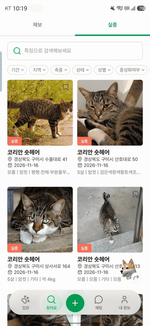</td>
      <td align="left">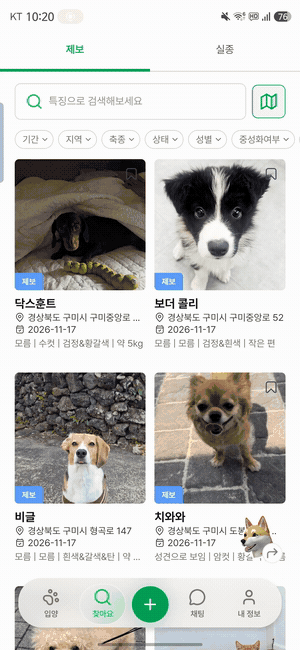</td>
    </tr>
  </tbody>
</table>

<table width="760">
  <thead>
    <tr>
      <th scope="col" width="380" align="left">발견 제보 조회</th>
      <th scope="col" width="380" align="left">AI 매칭 알림</th>
    </tr>
  </thead>
  <tbody>
    <tr>
      <td valign="top">발견 제보의 사진과 위치를 상세 화면과 지도에서 확인합니다.</td>
      <td valign="top">실종 동물과 닮은 후보가 생기면 알림을 받습니다. 아래 화면은 알림 목록의 ‘AI 매칭’ 탭 위치를 보여줍니다.</td>
    </tr>
    <tr>
      <td align="left">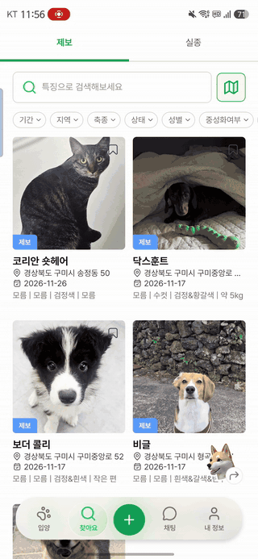</td>
      <td align="left">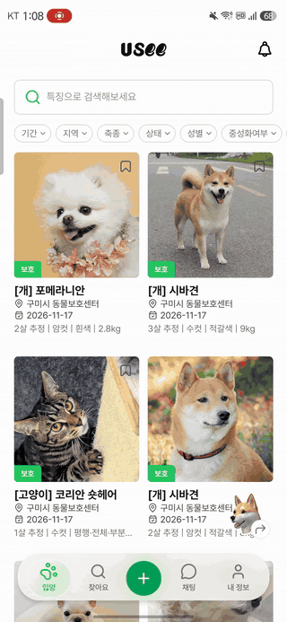</td>
    </tr>
  </tbody>
</table>

#### 입양 신청과 심사 확인

<table width="760">
  <thead>
    <tr>
      <th scope="col" width="380" align="left">입양 신청서 제출</th>
      <th scope="col" width="380" align="left">신청 접수부터 최종 승인까지</th>
    </tr>
  </thead>
  <tbody>
    <tr>
      <td valign="top">보호 동물의 상세 화면에서 입양 신청서를 작성하고 제출합니다.</td>
      <td valign="top">입양 신청 내역에서 접수, 심사 진행, 최종 승인 상태를 확인합니다.</td>
    </tr>
    <tr>
      <td align="left">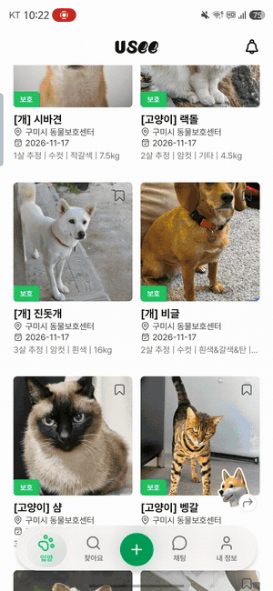</td>
      <td align="left">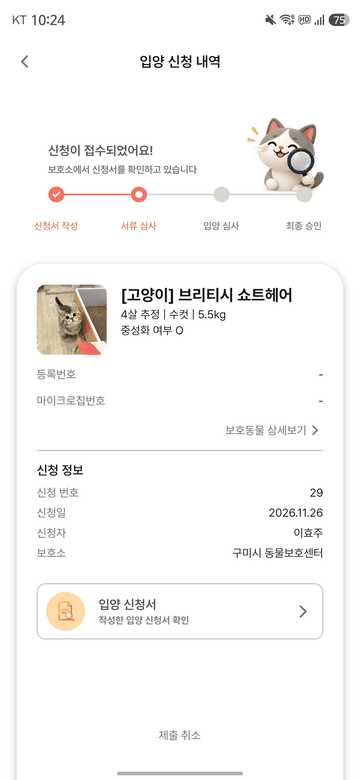</td>
    </tr>
  </tbody>
</table>

#### 모의 입양

<table width="760">
  <thead>
    <tr>
      <th scope="col" width="380" align="left">밥·물 주기</th>
      <th scope="col" width="380" align="left">상점에서 용품 구비하기</th>
    </tr>
  </thead>
  <tbody>
    <tr>
      <td valign="top">사료와 물을 챙겨 반려동물의 포만감과 수분을 관리합니다.</td>
      <td valign="top">정해둔 예산 안에서 사료, 간식, 산책용품 등 필요한 물품을 구매합니다.</td>
    </tr>
    <tr>
      <td align="left">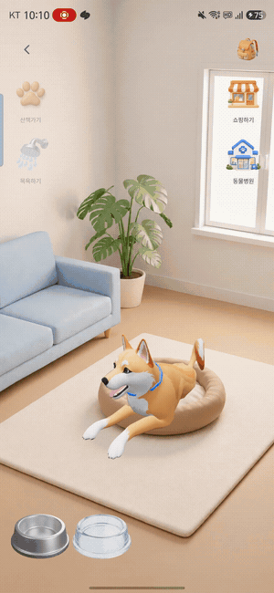</td>
      <td align="left">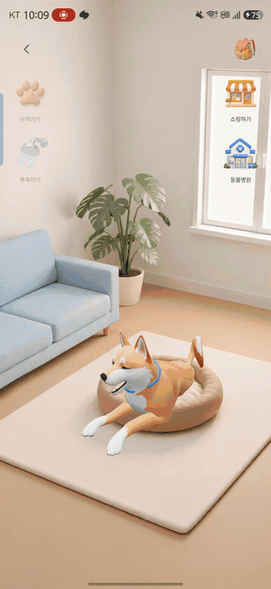</td>
    </tr>
  </tbody>
</table>

<table width="760">
  <thead>
    <tr>
      <th scope="col" width="380" align="left">모의 입양 시작</th>
      <th scope="col" width="380" align="left">놀아주기 · 간식 주기</th>
    </tr>
  </thead>
  <tbody>
    <tr>
      <td valign="top">반려동물과 이름, 첫 주 예산을 정해 체험을 시작합니다. 이전 체험의 리포트도 확인할 수 있습니다.</td>
      <td valign="top">장난감을 던져 반려동물과 놀거나 준비한 간식을 줍니다.</td>
    </tr>
    <tr>
      <td align="left">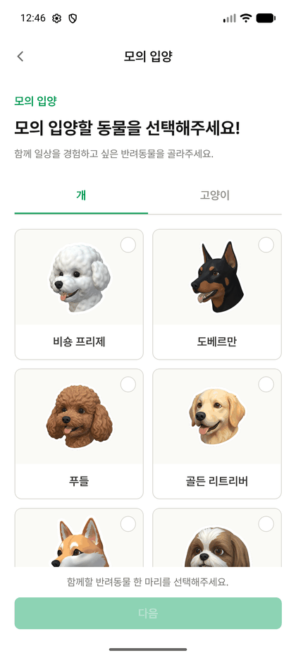</td>
      <td align="left">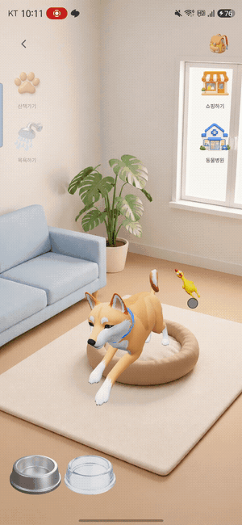</td>
    </tr>
  </tbody>
</table>

#### AR 산책

<table width="760">
  <thead>
    <tr>
      <th scope="col" width="380" align="left">AR 산책</th>
      <th scope="col" width="380" align="left">AR 산책 중 돌발 이벤트</th>
    </tr>
  </thead>
  <tbody>
    <tr>
      <td valign="top">Android에서 카메라가 인식한 바닥에 가상 반려동물을 배치하고 함께 걷습니다.</td>
      <td valign="top">산책 중 배변 이벤트가 발생하면 안내를 확인하고 뒤처리를 합니다.</td>
    </tr>
    <tr>
      <td align="left">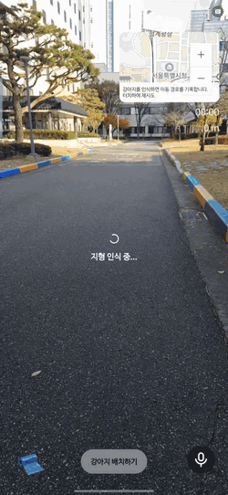</td>
      <td align="left">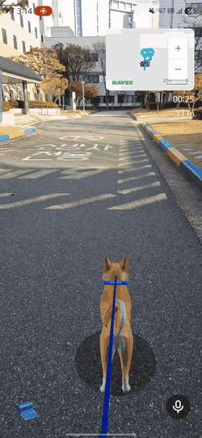</td>
    </tr>
  </tbody>
</table>

### 보호소 웹

웹 데모는 로컬 환경에서 예시 데이터로 시연했습니다.

<table width="760">
  <thead>
    <tr>
      <th scope="col" width="380" align="left">보호 동물 등록·관리</th>
      <th scope="col" width="380" align="left">입양 신청 심사</th>
    </tr>
  </thead>
  <tbody>
    <tr>
      <td valign="top">사진과 기본 정보를 입력하고, 목록과 상세 화면에서 등록 결과와 보호 상태를 확인합니다.</td>
      <td valign="top">신청서와 모의 입양 리포트를 검토하고, 서류 심사부터 최종 승인까지 진행합니다.</td>
    </tr>
    <tr>
      <td align="left"><a href="docs/readme/web-animal-registration.gif">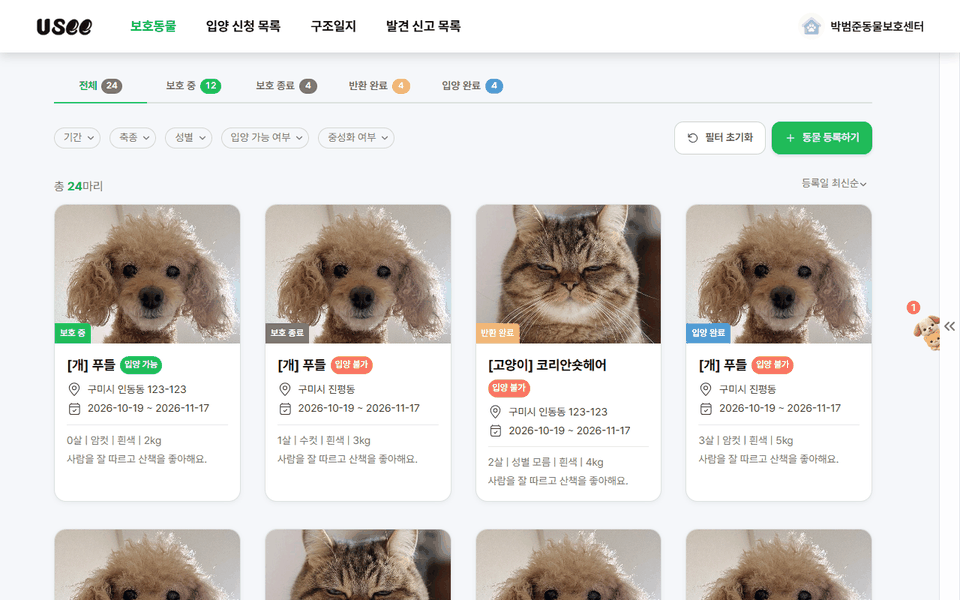</a></td>
      <td align="left"><a href="docs/readme/web-adoption-review.gif">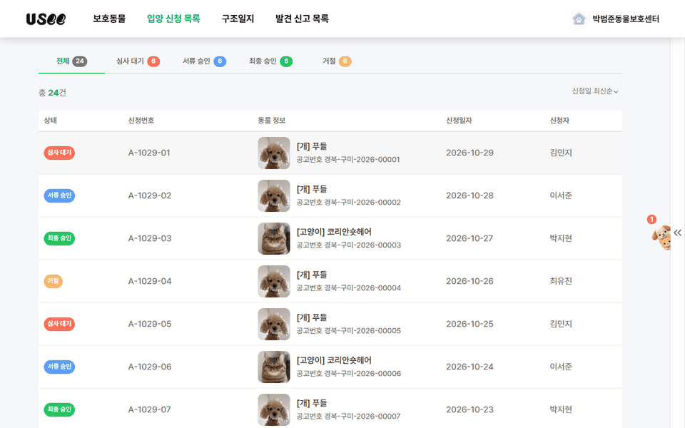</a></td>
    </tr>
  </tbody>
</table>

보호소용 돌봄 리포트 예시 보기

## 기술 하이라이트

### 가상 반려동물이 걸을 수 있는 길 찾기

- **바닥 인식** · ARCore로 바닥의 위치와 높이를 추적합니다. Android에서 ONNX Runtime으로 SegFormer B0를 실행해 카메라 영상 속 바닥·잔디·인도를 구분합니다.
- **우회 경로** · 벽이나 단차로 길이 막히면 확인된 바닥에서 `A*`로 우회로를 찾습니다. 경로가 없으면 멈춥니다.

[바닥 인식과 경로 탐색 상세](mobile/android/app/src/main/assets/models/segformer/README.md)

### 실종 사진과 닮은 동물 찾기

실종 사진을 발견 제보·보호 동물 사진과 비교해 같은 동물일 가능성이 있는 후보를 찾습니다.

- **개** · YOLO11m-seg로 몸 영역을 분리하고 BowwowID로 특징을 추출합니다.
- **고양이** · ECPose로 얼굴을 정렬하고 MeowID로 특징을 추출합니다. 얼굴 특징을 얻기 어려우면 몸 특징을 사용합니다.
- **후보 비교** · RabbitMQ 워커가 신고 접수와 별도로 사진을 512차원 특징 벡터로 변환합니다. pgvector에서 코사인 유사도를 계산해 후보를 정렬합니다.

### 발견 사진 여러 장으로 품종 추천

- **종과 품종 분류** · CLIP으로 개와 고양이를 구분하고, 해당 종으로 판정된 사진에 ConvNeXt-Tiny를 적용합니다.
- **추천 기준** · 사진별 품종 점수를 평균합니다. 기준에 미달하면 사용자가 품종을 직접 선택합니다.

발표 검증셋에서 품종 분류 Top-1 정확도는 **개 97.52%, 고양이 93.98%**였습니다. 이 수치는 지원 품종 분류에 대한 평가입니다.

### 돌봄 기록과 대조하는 모의 입양 요약

- **요약 생성** · 서버가 돌봄 횟수와 지출을 집계해 근거와 입양 안내 문구를 LLM에 전달합니다.
- **숫자 검증** · 입력에 없는 숫자가 나오거나 필요한 예산 금액이 빠지면 다시 생성합니다.
- **실패 복구** · 재시도에도 실패하면 규칙 기반 요약을 저장합니다. 처리 중 누락된 요약은 스케줄러가 찾아 다시 처리합니다.

## 아키텍처

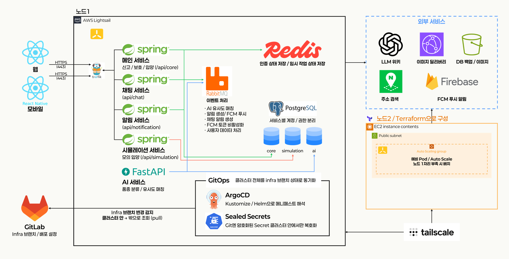

- **서비스 분리** · Core API, 채팅, 알림, 시뮬레이션을 독립 배포하고, PostgreSQL은 서비스별 스키마와 계정을 분리합니다. 품종 추천은 내부 HTTP로 호출하고, 개체 매칭은 RabbitMQ 큐에서 처리합니다.
- **배포와 운영** · GitLab CI가 변경된 서비스의 이미지를 빌드하고 Kustomize 매니페스트의 태그를 갱신합니다. Argo CD가 변경을 k3s에 반영합니다. Prometheus·Grafana로 메트릭을 확인하고 Loki·Alloy로 로그를 수집합니다. PostgreSQL 백업은 S3에 보관합니다.

## 기술 스택

| 영역 | 주요 기술 |
| --- | --- |
| Mobile | React Native, TypeScript, Zustand, Kakao Login, Naver Maps, Firebase Messaging, Android ARCore |
| Web | React, TypeScript, Vite, TanStack Query, Zustand, STOMP.js |
| Backend | Kotlin, JDK 21, Spring Boot, Spring Security, JPA, QueryDSL, Flyway, STOMP WebSocket, RabbitMQ |
| 데이터 · 외부 연동 | PostgreSQL, pgvector, Redis, AWS S3, Firebase Cloud Messaging, OpenAI API |
| AI | Python, FastAPI, PyTorch, CLIP, ConvNeXt-Tiny, BowwowID, MeowID, ONNX Runtime |
| 인프라 | AWS Lightsail·EC2, Terraform, Docker, k3s, Traefik, cert-manager, GitLab CI, Argo CD, Kustomize, Sealed Secrets, Tailscale |
| 관측 · 검증 | Prometheus, Grafana, Loki, Alloy, k6 |

## 팀원 소개

| 프로필 | 이름 | GitHub | 담당 파트 · 주요 작업 |
| :--- | :--- | :--- | :--- |
|  | **박범준 (팀장)** | [@10-005](https://github.com/10-005) | Backend · 모의 입양, 돌봄 리포트, 알림 |
|  | 김상현 | [@newrhyme](https://github.com/newrhyme) | Backend · AI 연동, 인프라 |
|  | 김채린 | [@chrin05](https://github.com/chrin05) | Mobile · 모의 입양, AR 산책 |
|  | 양혜림 | [@hhhhyelim](https://github.com/hhhhyelim) | Mobile · 실종·발견 신고, 지도, 채팅·상점 연동 |
|  | 이한준 | [@melonjul](https://github.com/melonjul) | AI 이미지 매칭 기술 구현 |
|  | 이효주 | [@barleymilk](https://github.com/barleymilk) | Web · 보호 동물 관리, 입양 심사, 채팅 |
|  | 채지현 | [@hellohyun4](https://github.com/hellohyun4) | AI 이미지 매칭 기술 구현 |

## 개발 가이드

| 영역 | 개발 브랜치 | 시작하기 |
| --- | --- | --- |
| 모바일 앱 | `develop-mobile` | [모바일 README](mobile/README.md) · [Android·iOS 개발 환경 가이드](mobile/docs/DEVELOPMENT.md) |
| 보호소 웹 | `develop-web` | [웹 README](https://lab.ssafy.com/s15-final/S15P31D106/-/blob/develop-web/web/README.md) · Node.js 24, `npm ci`, `npm run dev` |
| 백엔드 | `develop-backend` | [백엔드 README](https://lab.ssafy.com/s15-final/S15P31D106/-/blob/develop-backend/backend/README.md) · JDK 21, 로컬 Docker Compose |
| AI | `develop-ai` | [품종 추천 서버](https://lab.ssafy.com/s15-final/S15P31D106/-/blob/develop-ai/ai/breed-server/README.md) · [개체 매칭 워커](https://lab.ssafy.com/s15-final/S15P31D106/-/blob/develop-ai/ai/match-worker/README.md) |
| 인프라 | `infra` | [Argo CD 진입점](https://lab.ssafy.com/s15-final/S15P31D106/-/blob/infra/infra/argocd/root.yaml) |

[Git·Jira 협업 규칙](docs/CONVENTION.md)
